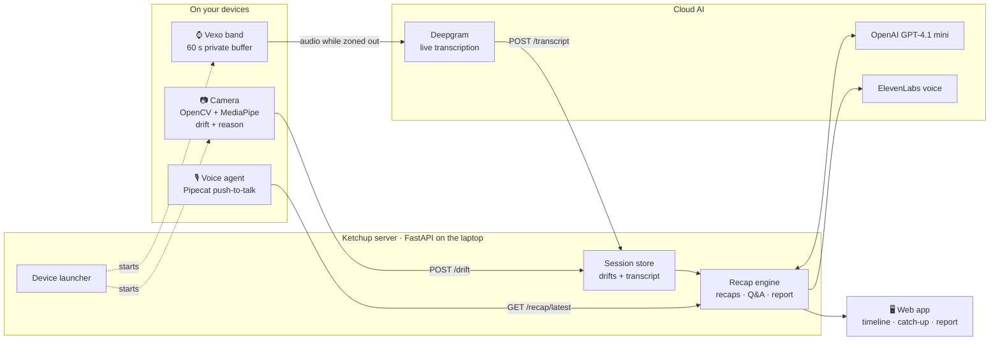

<div align="center">

# 🍅 Ketchup

### Zone out. Catch up.

**A wearable that pays attention with you.** Ketchup notices the moment your mind drifts in a lecture, keeps listening while you're gone, and tells you exactly what you missed when you're back.

Built in six hours at **VexoHacks** · Stanford · November 14, 2026


</div>

---

## The problem

Students mind-wander for about **a third of every lecture** ([Wammes et al.](https://www.noba.to/blog/2016-07-25-are-your-students-paying-attention)). In a 90-minute class, that's 30 minutes gone, every class, every day.

The worst part: you don't notice when you drift. One tab switch and the professor is three slides ahead. After class you're scrubbing a 90-minute recording looking for the part you missed, if there even is a recording.

## What Ketchup does

| | |
| --- | --- |
| 👀 **Notices** | An outward-facing camera knows what paying attention looks like for *you*. Your C++ code that matches the lecture? Focused. An Amazon tab? Drift, flagged within seconds, with the reason. |
| 👂 **Listens** | The Vexo band keeps the last minute of the lecture in memory on your laptop, and streams to transcription **only while you're zoned out**. |
| ⏪ **Catches you up** | Ask *"What did I miss?"* and hear a 20-second recap of exactly that gap, with the professor's exact words underneath. Ask follow-ups in plain language. |
| 📈 **Coaches you** | End the session for a report: how much you missed, why you drifted, what the lecture covered, and three things to try next class. Every session is saved, so you can see your focus change week to week. |

## The life of one drift

1. **You switch to Amazon.** The camera stops matching your saved lecture views, spots a screen, and GPT-4.1 mini checks it against what the professor is saying right now: *not related*. Ketchup beeps and marks `3:12 · Online shopping page` on your timeline.
2. **The band starts sharing.** It has been holding the last 60 seconds of lecture audio in memory. Now that minute, plus live audio, streams to Deepgram and comes back as timestamped transcript.
3. **You come back.** Ketchup waits 6 seconds for the last words, takes exactly the transcript inside your drift, and has GPT-4.1 mini write a recap. ElevenLabs voices it before you even ask.
4. **You ask "What did I miss?"** From the web app, or hands-free through the Pipecat voice agent (push-to-talk). The recap plays, the missed lines light up, and you can keep asking questions.
5. **Class ends.** The report appears instantly; the AI-written summary, patterns and tips fill in a few seconds later. A ketchup bottle pops up to cheer you on, or roast you a little.

## Architecture



## Technical highlights

- **Context-aware drift detection.** ORB feature matching against saved lecture views decides "on target". Off target, MediaPipe object detection finds phones, laptops and notes, and a vision model judges the screen against the live transcript, so related work stays focused.
- **Two devices, one clock.** The camera and the band run as separate programs and never talk to each other. Every event carries a Unix timestamp, and the server lines drifts up with transcript lines after a 6-second settle window, so late words still land in the right recap.
- **Privacy by design.** Audio sits in a 60-second rolling buffer on the laptop and is sent for transcription only while a drift is open (`GET /focus`). Camera frames never leave the laptop; only "when" and "why" do.
- **Grounded answers.** Recaps and follow-up answers are generated only from the transcript slice around your drift, and the exact lines are shown beside every summary.
- **Fast under pressure.** Recap audio is generated as soon as a drift ends, the end-of-session report renders immediately and fills in AI sections asynchronously, and every AI call has its own time limit so one slow request can't stall the demo.
- **One-click hardware.** The web app starts the camera and connects the Vexo band (Bluetooth or USB) through the server, with step-by-step pairing instructions.

## Built with

**Vexo band** (microphone, LED) · **Deepgram** nova-3 (streaming speech-to-text) · **OpenAI** GPT-4.1 mini (recaps, Q&A, reports, screen relevance) · **ElevenLabs** (voice) · **Pipecat** (voice agent) · **OpenCV** + **MediaPipe** (vision) · **FastAPI** · vanilla JS

## Run it

```bash
git clone https://github.com/erin-at23/Ketchup.git && cd Ketchup
git clone https://github.com/VexoAI-Org/vexo-open-kit.git
cp .env.example .env                 # OpenAI, Deepgram, ElevenLabs keys
cp camera/.env.example camera/.env

python3 -m venv .venv && source .venv/bin/activate
pip install -r backend/requirements.txt -r audio/requirements.txt
(cd camera && python3 -m venv .venv && .venv/bin/pip install -r requirements.txt)

cd backend && uvicorn main:app --port 8001
```

Open **http://localhost:8001** → **Start session** → **Start camera** (point at the slides, **Save lecture view**) → **Connect band** (double-tap the band, follow the steps). Zone out, come back, press **What did I miss?**

Shortcuts: `D` mark zoned out · `Space` what did I miss · `V` ask out loud. Voice agent: see [`voice/README.md`](voice/README.md). API docs: `http://localhost:8001/docs`.

## Repo

| | |
| --- | --- |
| [`backend/`](backend) | FastAPI server and the web app (`static/index.html`) |
| [`camera/`](camera) | drift detection |
| [`audio/`](audio) | Vexo band → Deepgram transcript |
| [`voice/`](voice) | Pipecat push-to-talk voice agent |

## What's next

- **Nudges on the band itself:** its LED can already blink after a long drift (`--nudge`); next is turning that on from the web app with a delay you choose.
- **Phone app** so the camera and catch-up work without a laptop.
- **On-device transcription** so no lecture audio ever leaves your devices.
- **Opt-in class insights** for instructors: which moments lose the room, never who drifted.

## Team

Built by **Erin** and **Charlotte** at VexoHacks 2026.
